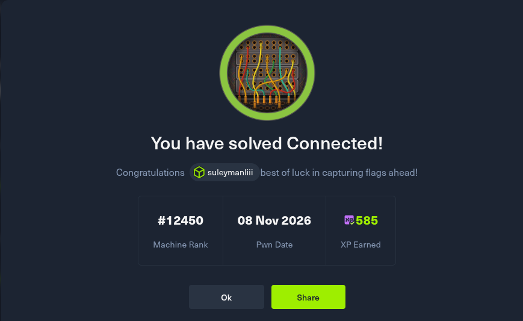

# Cybersecurity Lab Reports

A portfolio of authorized cybersecurity training work, including technical reports for retired Hack The Box machines and **non-spoiler completion evidence** for machines that were active when solved.

## Retired machines — technical reports

| Machine | Platform | Difficulty | OS | Topics | Report |
| --- | --- | --- | --- | --- | --- |
| [Cap](reports/cap/README.md) | Hack The Box (retired) | Easy | Linux | Service enumeration, IDOR, PCAP analysis, credential reuse, Linux capabilities | [Read report](reports/cap/README.md) |
| [TwoMillion](reports/twomillion/README.md) | Hack The Box (retired) | Easy | Linux | Invite API analysis, access control, command injection, credential reuse, CVE-2023-0386 | [Read report](reports/twomillion/README.md) |

## Active machines — completion records only

| Machine | Platform | Difficulty | OS | Completed | Evidence | Report |
| --- | --- | --- | --- | --- | --- | --- |
| **Connected** | Hack The Box | Easy | Linux | **8 November 2026** | [Completion screenshot](completions/connected-2026-11-08.png) | **Intentionally withheld while active** |

### Why does Connected not have a report?

Connected was an **active Hack The Box machine on 8 November 2026**, the date of completion. Detailed solutions, exploit chains, commands, flags, and hints have **intentionally not been included** in this repository to respect HTB's active-machine content restrictions. The missing writeup is a publication decision, **not an incomplete attempt**. A technical report may be added when the machine officially retires and HTB permits walkthroughs.



## Repository organization

```text
reports/
  <machine-slug>/
    README.md           # Writeup for a retired, publication-eligible machine
    screenshots/        # Selected report evidence
    scripts/            # Optional original machine-specific tools
completions/
  <machine>-<date>.png  # Proof of completion; no active-machine spoilers
templates/
  machine-report.md     # Reusable technical-report template
docs/
  reporting-workflow.md
```

Optional directories are created only when there is material to put inside them. New machines are added to the appropriate section above; no empty report folders are needed for active content.

## Documentation and disclosure policy

- Work is restricted to authorized training environments.
- Reports explain investigation, evidence, root cause, and remediation without presenting guesses as verified findings.
- **Active machines:** completion metadata and screenshot only; no walkthroughs or hints, even though this repository is private.
- **Retired machines:** detailed writeups when the platform allows publication.
- Review screenshot contents and Git history before making the repository public; don't publish genuine secrets, session tokens, VPN configurations, or unrelated personal information.

For the reporting process, see [reporting workflow](docs/reporting-workflow.md) and [machine report template](templates/machine-report.md).

> **Current visibility:** Private. Historical Cap evidence contains lab artifacts that should be reviewed and sanitized, including past commits, before publication.
